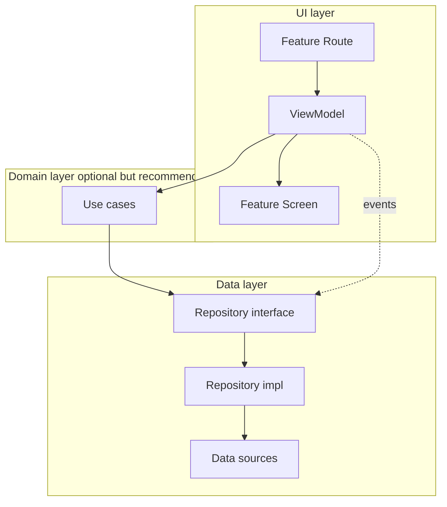

# HomeComing architecture

**HomeComing** is the project name only — UI copy and domain models stay generic until a concrete product problem is chosen.

This document follows [Guide to app architecture](https://developer.android.com/topic/architecture), [Now in Android (NIA)](https://github.com/android/nowinandroid), and [modularization patterns](https://developer.android.com/topic/modularization/patterns). It is the source of truth for how this repo is organized and where new code belongs.

## Principles (2025–2026 baseline)

| Principle | What it means here |
|-----------|-------------------|
| **Separation of concerns** | UI, domain, and data have distinct responsibilities and dependency direction. |
| **Unidirectional data flow (UDF)** | State flows up (Flows → ViewModel → Screen). Events flow down (callbacks → ViewModel → repository). |
| **Single source of truth** | Repositories own app data; ViewModels expose one `StateFlow` of UI state per screen. |
| **Reactive streams** | Kotlin `Flow` between data and UI; `stateIn(WhileSubscribed(5_000))` in ViewModels. |
| **Testability** | Constructor injection (Hilt); fake repositories and use cases in unit tests. |
| **Low coupling** | Features do not import other features; `core` never imports `feature`; app `navigation` wires the graph. |

## Layered model



- **UI layer**: Compose `Screen` (stateless), `Route` (wires ViewModel + nav callbacks), `ViewModel` (UI state holder).
- **Domain layer**: Small `operator fun invoke()` use cases that expose or combine repository streams. NIA uses domain for read/transform logic; **writes/events often go straight to repositories** from ViewModels ([NIA discussion](https://github.com/android/nowinandroid/discussions/1273)).
- **Data layer**: `EventRepository` is the public API; `GraphqlEventRepository` and network clients are `internal`.

## Current repo layout (single `:app` module)

Package structure mirrors a multi-module graph so Gradle extraction stays mechanical later.

```
com.homecoming.app/
├── MainActivity.kt              # Activity shell, edge-to-edge
├── HomeComingApp.kt             # Theme + root nav controller
├── HomeComingApplication.kt     # @HiltAndroidApp
├── navigation/                  # App NavHost + bottom bar (wires feature Routes)
├── di/                          # Hilt modules
├── core/
│   ├── model/                   # Pure models (no Android UI deps)
│   ├── domain/                  # Use cases
│   ├── data/                    # Repositories + data sources
│   ├── designsystem/            # Theme, tokens, shared UI primitives
│   └── navigation/              # Route types, top-level destinations, NavController helpers
└── feature/
    ├── home/                    # HomeRoute, HomeScreen, HomeViewModel, HomeUiState
    ├── events/
    └── profile/
```

### Feature module pattern (UI)

| Type | Role |
|------|------|
| `*UiState` | Immutable snapshot for one screen (`@Immutable` when using Compose stability). |
| `*Screen` | Composable: `(uiState, onEvent) -> Unit` — no ViewModel, no navigation. |
| `*Route` | Collects state from ViewModel; passes navigation lambdas into Screen. |
| `*ViewModel` | `@HiltViewModel`; maps Flows → `StateFlow<*UiState>`. |

## Target Gradle modularization (NIA-style)

When build times or team size grow, split along these modules ([NIA modularization](https://github.com/android/nowinandroid/blob/main/docs/ModularizationLearningJourney.md)):

```
:app                          # Wiring, MainActivity, app NavHost, Hilt entry
:baseline-profile
:core:model                   # JVM — Event, HomeHighlight
:core:domain                  # JVM — use cases
:core:data                    # Repositories, Room/DataStore/network later
:core:designsystem            # Material theme + shared composables
:core:navigation              # Route types, NavController extensions
:feature:home:api             # Navigation keys / public feature API
:feature:home:impl            # Home UI + ViewModel
:feature:events:api | :impl
:feature:profile:api | :impl
```

**Dependency rules**

- `:app` → all feature `impl` + required `core`.
- Feature `impl` → same feature `api`, other features’ `api` only, and `core`.
- Feature `api` → minimal (often `core:navigation` + serialization).
- `core:*` → never depend on `:app` or `:feature:*`.

See [MODULARIZATION_ROADMAP.md](MODULARIZATION_ROADMAP.md) for phased extraction.

## Navigation

- Type-safe routes: `@Serializable sealed interface Route` with `data object` destinations.
- Top-level tabs: `navigateToTopLevel()` with `popUpTo(findStartDestination())`, `launchSingleTop`, `restoreState`.
- Future: move each feature’s route type into `feature:*:api` ([modularize navigation](https://developer.android.com/guide/navigation/navigation-3/modularize)).

## Dependency injection

[Hilt](https://developer.android.com/training/dependency-injection/hilt-android) binds:

- `EventRepository` → `GraphqlEventRepository` (fakes in unit tests when added).
- Use cases and `@HiltViewModel` ViewModels.

No service locators or `companion object` defaults on repositories.

## Data evolution path

Today: GraphQL over OkHttp to the Spring backend (`BuildConfig.GRAPHQL_URL`); empty states when the database has no rows.

Next steps (typical production stack):

1. Apollo codegen + persisted queries; optional `:core:database` (Room) for offline-first.
2. Repository coordinates local cache + remote (as in [data layer guide](https://developer.android.com/topic/architecture/data-layer)).
3. Domain use cases combine streams when rules get non-trivial.

## Quality and performance (already in repo)

- R8 full mode, resource shrinking, baseline profile module.
- Compose compiler reports (debug).
- Strings in `res/values/strings.xml`.

## References

- [App architecture guide](https://developer.android.com/topic/architecture)
- [UI layer](https://developer.android.com/topic/architecture/ui-layer) · [Data layer](https://developer.android.com/topic/architecture/data-layer) · [Domain layer](https://developer.android.com/topic/architecture/domain-layer)
- [Now in Android — architecture](https://github.com/android/nowinandroid/blob/main/docs/ArchitectureLearningJourney.md)
- [Common modularization patterns](https://developer.android.com/topic/modularization/patterns)
