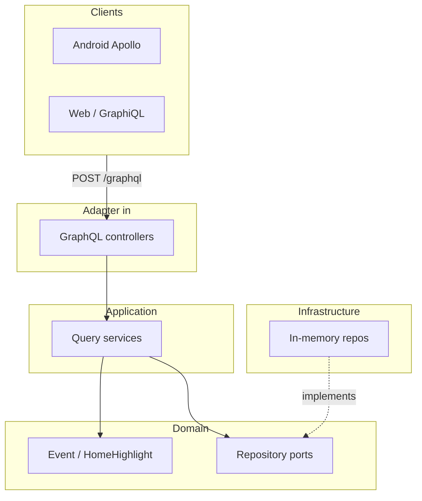

# HomeComing backend architecture

Spring Boot **3.5** service in `backend/`. **GraphQL** is the public API contract; HTTP serves `/graphql` only (plus Actuator). Android and web clients share one schema.

## Stack choice: GraphQL (not REST for product API)

| | GraphQL here | REST (not used for domain) |
|--|----------------|----------------------------|
| **Clients** | Android (Apollo), web, admin — each picks fields | Fixed DTOs per endpoint; over/under-fetching |
| **Evolution** | Add fields to `schema.graphqls`; old clients keep working | Versioned `/api/v1` duplication |
| **Future** | Subscriptions for live schedule updates | Polling or SSE bolted on |

Actuator remains REST (`/actuator/health`) — infrastructure, not product API.

## Layered design (hexagonal)

| Layer | Package | Rules |
|-------|---------|--------|
| **Domain** | `domain.*` | Pure Java records + repository **ports** (interfaces). No Spring. |
| **Application** | `application.*` | Use cases (`*QueryService`); depend on ports only; business rules live here. |
| **Infrastructure** | `infrastructure.*` | Adapters: in-memory repos today; JPA/Redis/HTTP clients later. |
| **Adapter (in)** | `adapter.graphql` | `ScheduleQueryController` — `@QueryMapping` only; no business rules. |
| **Domain errors** | `domain.exception` | Sealed `DomainException` hierarchy (e.g. `ResourceNotFoundException`). |
| **Config** | `config` | CORS, `@ConfigurationProperties`, no business logic. |
| **Common** | `common.error` | `GraphQlErrorAdvice` maps domain exceptions to GraphQL error types. |

Dependency direction: **adapter → application → domain ← infrastructure**.



## Schema (source of truth)

File: `backend/src/main/resources/graphql/schema.graphqls`

- `Query.events` / `Query.event(id)` / `Query.homeHighlight`
- Types mirror Android `Event` and `HomeHighlight` field names.

Runtime wiring: Spring GraphQL maps schema fields to `@QueryMapping` methods. Domain records expose the same property names (JavaBean / record accessors).

## Errors

`ResourceNotFoundException` → GraphQL error with `ErrorType.NOT_FOUND` (not a stack trace in the response body).

## Configuration

- `application.yml` — GraphQL path, GraphiQL (local), CORS patterns
- `application-local.yml` — debug logging
- `homecoming.api.cors-allowed-origin-patterns` — emulator (`10.0.2.2`) + localhost

## Run & test

```powershell
$env:JAVA_HOME = 'C:\Program Files\Eclipse Adoptium\jdk-17.0.18.8-hotspot'
.\gradlew.bat :backend:bootRun
```

- GraphQL: `POST http://localhost:8080/graphql`
- GraphiQL: `http://localhost:8080/graphiql`
- Health: `GET http://localhost:8080/actuator/health`

Example query:

```graphql
query HomeScreen {
  homeHighlight { title dates }
  events { id title scheduleLabel location }
}
```

Tests: `.\gradlew.bat :backend:test` (`@GraphQlTest`, unit tests on application services).

## Database (PostgreSQL + Flyway)

| Piece | Location |
|-------|----------|
| **Docker** | `docker-compose.yml` — Postgres 16, db/user/password `homecoming` |
| **Migrations** | `backend/src/main/resources/db/migration/` (Flyway, `ddl-auto: validate`) |
| **JPA entities** | `infrastructure.persistence.jpa.entity` (not exposed to domain) |
| **Adapters** | `JpaEventRepository`, `JpaHomeHighlightRepository` implement domain ports |
| **Seed data** | None — populate via admin/API when you define your use case |

Local:

```powershell
docker compose up -d
$env:JAVA_HOME = 'C:\Program Files\Eclipse Adoptium\jdk-17.0.18.8-hotspot'
.\gradlew.bat :backend:bootRun
```

Tests use **H2** in PostgreSQL compatibility mode with the same Flyway scripts (`test` profile).

If Flyway complains after pulling (removed `V2__seed_schedule`), reset local Postgres: `docker compose down -v && docker compose up -d`.

## Roadmap

1. Spring Security + JWT at the HTTP/GraphQL transport layer.
2. GraphQL **subscriptions** for live schedule (reuse application services).
3. Apollo Android client + persisted queries in the app module.
